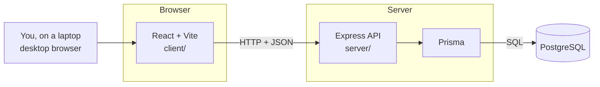
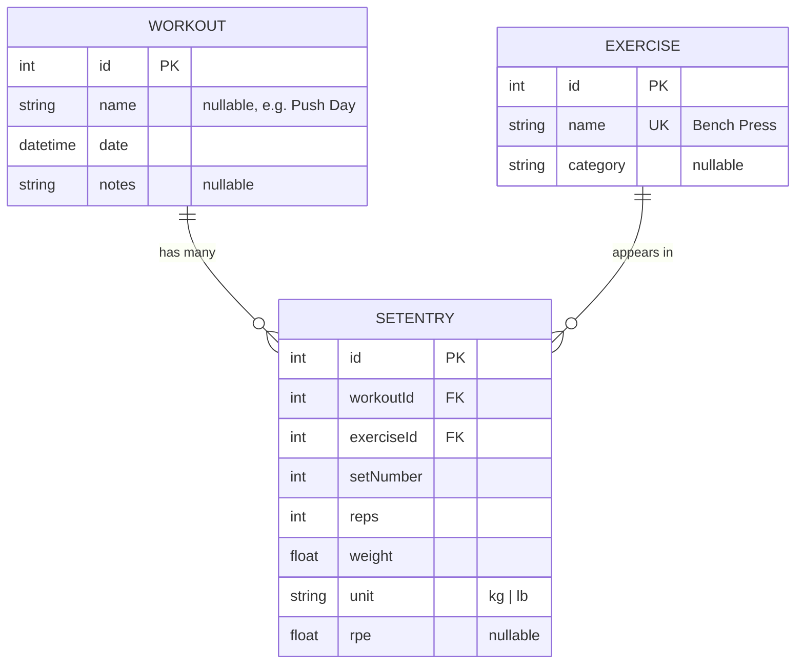
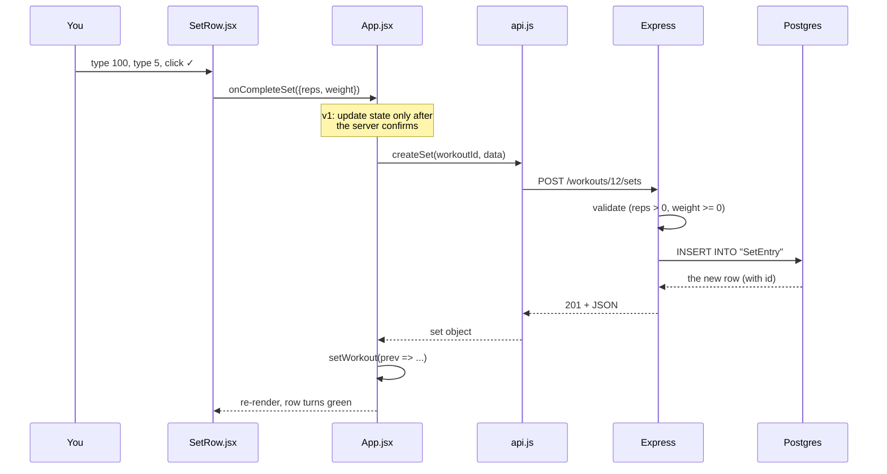

# Gym Tracker: Architecture

> [!info] How to use this doc
> This is the blueprint we build from. It is a **draft to argue with** — edit anything here before we write code. Related: [[00-overview]], [[data-model]], [[api-contract]], [[roadmap]].

---

## 1. The big picture

Three separate pieces. React never talks to the database.



| Piece | Job | Knows about |
|---|---|---|
| React | Draw screens, hold what's on screen right now | The API's URLs only |
| Express | Rules, validation, deciding what's allowed | Prisma + the DB |
| Prisma | Turn JS calls into SQL | PostgreSQL |
| PostgreSQL | Remember things forever | Nothing |

**The contract between them is the route** (method + URL + JSON shape). As long as that holds, either side can be rebuilt without touching the other. That's also why we can build the frontend first against fake data.

> [!important] The one rule that makes frontend-first work
> Mock data must be **shaped exactly like the real API response**. Then swapping to the real backend is a one-line change per call: `MOCK_WORKOUTS` becomes `await getWorkouts()`. If the shapes drift, we pay for it later with a rewrite.

---

## 2. Data model



Three tables, one join table in the middle. Full Prisma schema in [[data-model]].

**Why `SetEntry` is its own table and not a JSON blob on `Workout`:** every interesting question is a question about *sets across workouts*. "Best bench e1RM ever", "weekly volume", "am I stalling". Those are one-line SQL against a real table, and misery against a blob.

**Why no `User` table yet:** auth is a later phase and you haven't learned it. Adding it later = one column (`userId` on `Workout`) plus scoping every query. Designed for, not built.

**Derived values are never stored.** e1RM, PRs, and volume are computed when read:

```js
// Epley formula
const e1rm = weight * (1 + reps / 30)
```

Store `weight` and `reps`; compute the rest. If you edit a set from three weeks ago, every number that depends on it is instantly correct. No stale cache, no recalculation job. If it ever gets slow, *then* cache it.

---

## 3. API contract

Full table in [[api-contract]]. The shape React receives:

```jsonc
// GET /workouts/:id
{
  "id": 12,
  "name": "Push Day",
  "date": "2026-09-18T18:30:00.000Z",
  "notes": null,
  "sets": [
    { "id": 40, "exerciseId": 2, "exerciseName": "Bench Press",
      "setNumber": 1, "reps": 5, "weight": 100, "unit": "kg", "rpe": 8 }
  ]
}
```

`exerciseName` is joined in by the server so React never has to cross-reference two lists to draw one row.

---

## 4. What happens when you log a set



**Server-confirmed, not optimistic.** The row only turns green once the database says yes. Slightly slower, but it can never lie to you — and optimistic updates need rollback logic you don't need yet. Watch this in DevTools → Network while building.

---

## 5. Frontend architecture

> [!info] Moved to section 10
> The first frontend design (old 5.1 to 5.6: generic dark UI, no router, StatCard/WorkoutCard) was replaced on 2026-09-21 and its text is **deleted from this note** so nothing stale is left to read. The current design, screens, component tree, state, and the ONE accurate file list are in [[#10. Frontend v2: "The Plate Ladder" (2026-09-21, supersedes 5.1 to 5.6)|section 10]]. Motion rules: [[motion-system]]. Why it changed: [[Decision - Plate Ladder redesign]].

---

## 6. Build order

One new React idea per phase. Nothing moves forward until the previous phase is understood.

| Phase | Build | New concept |
|---|---|---|
| **0** | Vite project, "Hello" on screen | Project scaffolding, dev server |
| **1** | Home screen, hardcoded, no interaction | JSX, components, props, `.map()`, `key` |
| **2** | Sidebar nav switches between blank screens | `useState`, event handlers, conditional render |
| **3** | Active Workout: type weight and reps | Controlled inputs, immutable updates |
| **4** | Confirm a set (click ☑ or Enter), row turns green, stats update | Lifting state up, derived values |
| **5** | e1RM, PR badge, weekly volume | Pure functions in `lib/calc.js` |
| **6** | Exercise library with live search | `.filter()`, derived state |
| **7** | Backend: schema, migration, seed, routes | Prisma + Express (already known — faster) |
| **8** | Replace `mock.js` with real `fetch` | `useEffect`, loading/error state, Network tab |
| **9** | Wire create / edit / delete | POST, PATCH, DELETE, `res.ok` |

Phases 0–6 need no database at all. You can build the entire interface before Postgres is involved.

---

## 7. Decisions already locked

| Decision | Why |
|---|---|
| JavaScript, not TypeScript | One new thing at a time |
| Plain CSS + flexbox | You know it; a framework is another syntax to learn |
| Vite, not Next.js | Backend is a separate Express server; Next blurs that line |
| React Router (added 2026-09-21) | Back button, refresh and bookmarks were broken without it. See [[Decision - Router and remodel]] |
| No state library | Ten components don't need one |
| Server-confirmed updates | Can't lie about what's saved |
| Mock data = API shape | Makes Phase 8 a swap, not a rewrite |
| Dark, desktop-first | Decided 2026-09-20: website for now. Mobile later via a media query on the same flexbox layout |

---

## 8. Open questions

> [!success] Answered 2026-09-21 with defaults
> kg only, RPE stored but no input, rest timer v2, no warm-up sets, the 12 seed exercises. Full table and reasons: [[Decision - Frontend defaults]]. Change any answer and the affected part gets rebuilt.

Answer these and the plan is final.

1. **kg or lb?** Assuming kg throughout. The `unit` column exists either way.
2. **RPE: required or optional?** Currently optional. Including it adds a third input to every row — more to fill in.
3. **Rest timer in v1 or v2?** Currently v2. It needs `useEffect` + `setInterval` + cleanup, which is a genuinely tricky lesson to bolt onto Phase 4.
4. **Warm-up sets?** Strong marks them separately so they don't pollute volume stats. Currently not modelled.
5. **Which exercises to seed?** Proposed: Squat, Bench Press, Deadlift, Overhead Press, Barbell Row, Pull-up, Dip, Romanian Deadlift, Leg Press, Lateral Raise, Bicep Curl, Tricep Extension.

---

## 9. Not now

Explicitly out of scope, recorded so we don't drift into them: charts, programs/templates, rest timer, plate calculator, bodyweight log, offline/PWA, dataset import, auth, deployment, Docker, tests beyond `lib/calc.js`.

See [[roadmap]] for when each lands.

---

## 10. Frontend v2: "The Plate Ladder" (2026-09-21, supersedes 5.1 to 5.6)

The frontend was rebuilt after the first version was judged generic. Direction, verdicts and contract: [[design-research]] and `.impeccable/surfaces/client-src.md` in the project. Product record: `PRODUCT.md`.

### 10.1 The idea
A gym-wall chart that fills in as you lift. Iron greys, chalk-white ink, and **hue means exactly one thing: a plate weight** (25 kg red, 20 blue, 15 yellow, 10 green, 5 white). Colour appears only on drawn plates; lifts are told apart by name and, in charts, by line style. Numbers are lit seven-segment readouts with ghost cells. A PR is three referee lights. Every rule is a 1px hairline; no shadows, no blur, no gradients.

### 10.2 Screens and URLs (7)
| URL | Screen | What is on it |
|---|---|---|
| `/` | **Today** | Next-up session (rotation), the **Ladder** (big three: e1RM as segments, loaded bar, "n-plate club", kg to next), last 7 days strip, recent sessions |
| `/progress` | **Progress** | e1RM line chart for the big three with plate-club lines, weekly volume bars (8 weeks), latest records |
| `/history` | History | Sessions grouped by month, one row each |
| `/workouts/:id` | Workout Detail | Sets per exercise, loaded bars, e1RM, PRs, total volume readout |
| `/exercises` | Library | Search, add custom exercise, best e1RM and session count per lift |
| `/exercises/:id` | Exercise Detail | Best e1RM readout, loaded bar, trend chart, every session |
| `/active` | Active Workout | Sticky bar (name, elapsed, rest timer, progress), exercise blocks, set rows with plates |

### 10.3 Component tree
```
main.jsx  ── BrowserRouter ── App.jsx  (ALL state lives here)
App
├── Sidebar                       NavLink x4 + Start/Resume
└── Routes
    ├── HomeView ── LiftLadder (Segments, PlateBar), WeekStrip, WorkoutRow (PRBadge)
    ├── ProgressView ── LineChart, BarChart, PRBadge
    ├── HistoryView ── WorkoutRow
    ├── WorkoutRoute -> WorkoutDetailView ── PlateBar, PRBadge, Segments
    ├── ExercisesView ── ExerciseRow
    ├── ExerciseRoute -> ExerciseDetailView ── Segments, PlateBar, LineChart, PRBadge
    └── ActiveWorkoutView ── RestTimer (Segments), ExerciseBlock ── SetRow (PlateBar, PRBadge), ExercisePicker
```

### 10.4 State (all in `App.jsx`)
`exercises`, `workouts`, `active` (the draft, now with `startedAt`), `restSeconds`, `restEndsAt`. Derived on every draw, never stored: `prIds`, e1RM, volume, ladder, week strip, chart data. The URL is the source of truth for "which screen".

### 10.5 File layout
```
client/src/
  main.jsx  App.jsx  index.css  mock.js  api.js (written, not wired)
  lib/       calc.js  plates.js  active.js  format.js  paths.js  useNow.js  *.test.js
  components/ Segments PlateBar PRBadge RestTimer LiftLadder WeekStrip WorkoutRow ExerciseRow
              LineChart BarChart Sidebar SetRow ExerciseBlock ExercisePicker
  views/     HomeView ProgressView HistoryView WorkoutDetailView ExercisesView ExerciseDetailView ActiveWorkoutView
server/      src/{server,db,validate}.js  src/routes/{exercises,workouts}.js  prisma/{schema.prisma,seed.js}
```

### 10.6 Dependencies added and why (each is logged for learning)
| Package | Why |
|---|---|
| `react-router` 8.4 | Real URLs and a working Back button. |
| `@fontsource/barlow`, `@fontsource/barlow-condensed` | Self-hosted fonts (impeccable forbids a system display face). |
| `express`, `cors`, `@prisma/client`, `prisma` (server) | The backend. |

### 10.7 What you need to learn, and what you do not
The full tables live in the learning log: [[Lesson 4 - Router, Plate Ladder redesign and backend]], sections A to D of "Routing, the Plate Ladder redesign, and the backend". Short version:

**Learn (motion, planned, see [[motion-system]]):** the `motion` library (`<motion.div>`, `AnimatePresence`, `layoutId`, spring config, `useScroll`/`useTransform`, `useReducedMotion`, `staggerChildren`, `useAnimate`), plus easing, duration scale, transform/opacity-only, FLIP, stagger, reduced motion.

**Learn (already in the code):** port vs path; React Router; `useEffect` with cleanup and custom hooks; timestamp timers; hand-drawn SVG and scaling data to pixels; self-hosted fonts; CSS scoped variables, keyframe animation, `prefers-reduced-motion`, sticky, themed browser surfaces; ARIA basics; tabular figures; `Map`/`Set`/`reduce`/dates in JS; `node:test`. Backend: Express middleware order, CORS, server-side validation, Prisma schema/migrations/seed/transactions, HTTP status codes, `.env` secrecy, binding to `127.0.0.1`.

**Do NOT learn (deliberately avoided):** TypeScript, Tailwind or any CSS framework, chart libraries, GSAP and other animation libraries (the one we DO use is `motion`, see [[motion-system]]), state libraries (Redux, Zustand, Context, TanStack Query), `useMemo`/`useCallback`/`useRef`/`useContext`, component libraries, Next.js, React Testing Library/Vitest/Jest, Web Audio, PWA, Docker, CI/CD. CSS Grid is used only to centre things; layout is flexbox.

### 10.8 Still open
Wire `api.js` into the screens (Phase 8), then create/edit/delete (Phase 9). Blocked on `server/.env` (Postgres password). RPE input, warm-up sets, lb units and sound on rest end remain out of scope.

### 10.9 Motion (planned, nothing built yet)
Decided 2026-09-21: keep the Plate Ladder and add serious motion with the `motion` library (`motion/react`, about 35 KB). Rules, signature moments, the three mockups and the build gates are in [[motion-system]]. Dependencies to add when the user picks a mockup: `motion`. Until then `client/` is unchanged.

### 10.10 Known defects (open)
- `.rest.is-over` (green) and `.error` (red) use hues that are not plate weights, which breaks "one hue, one meaning".
- Chart-bar grey `#5c5a52` and bar-steel `#6f6d64` are hard-coded, not tokens.
- No `.git` repository yet; `server/.env` not created, so the database is not connected.

---

## 11. Feature roadmap and multi-user architecture (2026-09-21, from [[feature-research]])

The user will use the app personally with a real database, and other people will use it too. The research on Hevy, Strong, Fitbod, Liftosaur and powerlifting apps changed three things: **the data model becomes multi-user**, **features are added in tiers**, and **authentication becomes a required phase before anyone else uses it**.

### 11.1 Multi-user, done in the cheap order
1. **Now, before any real data exists:** add a `User` table and a `userId` to every user-owned row (schema v2 in [[data-model]]). Migrating later, with real data in the tables, is the painful path.
2. **Until auth exists:** a single middleware sets `req.user` to the one seeded owner. Every route reads `req.user.id` and filters by it. When auth is built, only that middleware changes.
3. **Rules that never change:** `userId` comes from the server (`req.user`), never from the request body. Someone else's row answers **404**, not 403. Every query that touches user data has `where: { userId }`.
4. **Auth phase (own lesson, gate before sharing):** bcrypt password hashing, session in an httpOnly cookie, CSRF protection, rate limit on login. Until this is built, the API stays bound to `127.0.0.1` and **nobody else can use the app**.
5. **Idempotent saves:** the browser generates a `clientId` (UUID) for each workout; the server has `@unique` on it, so a retried save cannot duplicate. The active draft is also kept in `localStorage` so a refresh or crash loses nothing.

### 11.2 Feature tiers (checklist lives in [[todo]])
| Tier | What | Comes from |
|---|---|---|
| **1. Foundation for real use** | Real persistence (wire `api.js`), draft survives refresh, edit/delete past workouts and sets, set types (warm-up, normal, drop, failure; warm-ups do not count as PRs or volume), RPE input, kg/lb unit, exercise notes, workout notes, routines/templates (start a workout from one), warm-up set calculator, body-weight log, CSV export and import (Strong/Hevy format), `pg_dump` backups | Hevy, Strong, offline-first trackers |
| **2. Consistency and insight** | **Consistency screen:** weekly streak (current and best), yearly heatmap of "blobs", multi-year view; monthly report; muscle-group volume (sets per muscle per week); Year in Review; PR timeline | Hevy, Streakout, Fitness Story |
| **3. Powerlifting** | RPE-adjusted e1RM, DOTS / Wilks / IPF GL score (coefficients copied from the official source, not from memory), 9-attempt meet planner, percentage programs (5/3/1, nSuns, GZCLP as data, training max), stall and deload detection | PrimedLifter, Hardy, RepCheck, Liftosaur, Alpha Progression |
| **4. Multi-user** | Auth phase, profile, per-user settings, later maybe share a routine by link | Hevy |
| **Not doing** | Social feed, leaderboards, AI trainer, wearable readiness, progress photos, Strava, native widgets, nutrition | needs moderation, hardware, storage or a native app |

### 11.3 Streaks and the yearly heatmap (spec)
- **Weekly streak.** Weeks start Monday (same as `weeklyVolumes`). A week counts if it has at least `weeklyTarget` sessions (user setting, default 3; Hevy uses 1). **The current, unfinished week never breaks the streak.** A missed week resets to zero; the longer streak is kept as `bestStreak`. (Hevy instead lets a later session extend the old streak after one missed week. We start simple and may copy that later.) Pure functions in `lib/streaks.js`, tested with `node:test`.
- **Yearly heatmap ("blobs").** 53 columns by 7 rows (Monday at the top), one cell per day. Each blob is a **circle whose area follows that day's volume** (`radius = k * sqrt(volume)`), coloured in the chalk-grey ramp (no new hue, honouring "hue = plate weight only"). PR days carry a small referee-light dot. Today has a ring. Hover or focus shows the workout and its total. Year switcher plus a multi-year strip. Levels come from the user's own quartiles so one heavy day does not flatten the rest.
- **Motion:** blobs ripple in from the left by column (stagger by index), the streak number counts up, year switch cross-fades. Reduced-motion: instant, no ripple. Ties into [[motion-system]].
- **Accessibility:** the heatmap has a text alternative (a table or list of the busiest weeks), because SVG blobs alone tell a screen reader nothing.

### 11.4 New screens and endpoints (planned)
| Screen | URL | Notes |
|---|---|---|
| Consistency | `/consistency` | streaks, yearly heatmap, monthly report, Year in Review |
| Routines | `/routines` | templates; "Start from routine" on Today |
| Body | `/body` | body-weight log and measurements |
| Settings | `/settings` | unit, weekly target, export/import, backup info |
| Meet | `/meet` | attempt planner and score (Tier 3) |

Endpoints to add in [[api-contract]] when built: routines CRUD, `GET/POST /bodyweight`, `GET /export.csv`, `POST /import`, `GET/PATCH /me` (settings). Everything scoped by `req.user.id`.

### 11.5 Build order (revised)
Schema v2 and `req.user` middleware → reference capture → motion primitives → Tier 1 → Consistency screen (Tier 2) → Tier 3 → wire everything to the API → checks → the one `.env` stop → migrate, seed, full test → **auth phase** → only then let anyone else use it. Each stage ends with checks, a local commit and a `STATE.md` update. Full sequence: [[CONTEXT]] section 9.

### 11.6 Learn list
Everything new here is in [[Lesson 6 - New features to learn]], with its own NOT-needed list.

## 12. What was built on 2026-09-21 (overrides 10.4, 10.5 and 10.10 where they differ)
- **State is no longer all in App.** Server data lives in `lib/useStore.js` (settings, exercises, workouts, routines, body weight; status loading/error/ready). The draft lives in `lib/useDraft.js` (state + localStorage). App keeps only the rest timer and save status. See [[Decision - Data layer and draft]].
- **Screens and URLs (12):** `/` Today, `/progress`, `/consistency` (streak, yearly blob heatmap, years, month vs month, muscle volume, year in review, PR timeline), `/history`, `/workouts/:id` (edit, delete, save as routine), `/exercises`, `/exercises/:id` (stall notice), `/routines`, `/body`, `/meet` (estimated total, DOTS, attempt planner, percentage table), `/settings` (unit, target, rest, sex, CSV export/import), `/active`.
- **New files:** `lib/{useStore,useDraft,useCountUp,units,streaks,reports,warmup,scores,csv,motion}.js`, `components/{Heatmap,Rise,CountUp}.jsx`, `views/{ConsistencyView,RoutinesView,BodyView,MeetView,SettingsView}.jsx`. Deleted: `mock.js`. Tests: 29 (`node --test`), plus 4 API tests in `server/test/api.test.js`.
- **Server:** `src/auth.js`, `src/routes/extras.js` (me, routines, body-weight), `scripts/backup.js`, `prisma/migrations/`. Endpoints: [[api-contract]].
- **Dependencies added:** `motion` 13 (client). Nothing else. Bundle: 478 KB JS, 21 KB CSS (was 302 and 18).
- **Defects 10.10 fixed:** `.rest.is-over` no longer green, errors no longer red (chalk plus the word "Problem:"), grey literals are tokens (`--bar-steel`, `--chart-bar`).
- **Known limits now:** charts, plates and plate clubs always use kg even when the display unit is lb; the DOTS coefficients came from a calculator site, not the federation; no auth; restore of a backup untested; the API is unauthenticated on 127.0.0.1 only.
