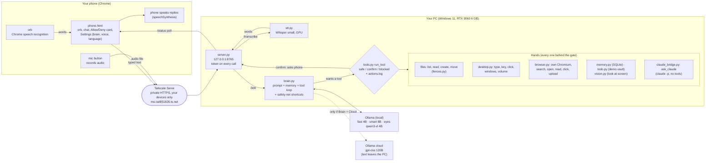

# Jarvis architecture (as built, 2026-10-03)

One page: what exists, how a request travels, what protects you, what is blocked. Code: `C:\dev\Virtual Assistant\`. Update this note whenever a part is added.

## The whole system on one picture

## A request, step by step
1. **You talk or type** on the phone. Typed text goes straight on. **Mic button:** the phone records, sends the audio to `/transcribe`, Whisper on the PC returns words into the message box (you press Send). **Orb:** Chrome's own speech engine (Google, online) fills the box instead.
2. **`/ask`** hands the text to `brain.py`: system prompt + remembered facts (`memory.db`) + the last N messages (4B: 12, 8B: 16, cloud: 60; a small model gets worse with long history, measured).
3. **Safety-net shortcuts** answer time, battery, to-do and windows questions in code, because the 4B model skips tools (10/10 with the net, 9/10 without).
4. The model replies, or asks for a **tool**. Every tool call goes through `run_tool`:
   - **safe** (time, battery, list/read files, tabs, volume, list memories/to-dos) runs at once.
   - **confirm** (open app, type, click, keys, windows, create/move file, browser search/open/click/upload, screen look, remember, to-do changes, ask_claude) shows **Allow / Deny** on the phone (60 s, no answer = deny).
   - **anything not in `LEVELS` = blocked.** One line per decision in `actions.log`.
5. The phone polls `/status` every 0.5 s, draws the reply, tool chips and the Allow card; on the final answer it speaks it.

## Brains (Settings > Brain, stored in `model.txt`)
| Choice | Model | Where it runs | Notes |
|---|---|---|---|
| fast | `huihui_ai/qwen3-abliterated:4b` | this PC | 2.5 GB, default, uncensored |
| smart | `huihui_ai/qwen3-abliterated:8b` | this PC | 5 GB of 6 GB VRAM, slower, not yet timed |
| cloud | `gpt-oss:120b-cloud` | Ollama's servers | fastest and smartest, **not uncensored, your text leaves the PC**, free-plan limits |
| eyes | `huihui_ai/qwen3-vl-abliterated:4b` | this PC | only for `look_at_screen` |

**Current setting: `smart`.** VRAM is the squeeze: Whisper `small` (about 1 GB) + the 8B (5 GB) do not both fit, so Whisper falls back to the CPU (works, slower). Whisper turbo (about 2.5 GB) needs the brain on fast or cloud.

## Voice
| Direction | How | Where | Quality |
|---|---|---|---|
| You to text (mic button) | MediaRecorder on phone, Whisper `small` on the PC (`stt.py`, GPU float16, CPU int8 fallback, VAD skips silence) | PC | good with accents; no live words, text appears after you stop |
| You to text (orb) | Chrome SpeechRecognition (Google, online) | phone + Google | weak with your accent; "English, India" helps |
| Text to you | phone's `speechSynthesis` (Piper male voices exist in `speak.py` for the PC) | phone | fine |
| Wake word "Hey Jarvis" | Chrome recognition, experimental, screen must stay on | phone | local wake word blocked (below) |

## Security, in layers
1. **Network:** server listens on `127.0.0.1` only; the phone reaches it through Tailscale Serve (your own devices, not public). No public URL.
2. **Token:** every route except the page needs the bearer token (constant-time compare, 1 s delay on a wrong one). Rotated 2026-10-03; phone stores it in the browser; QR scan or paste.
3. **Page:** strict CSP (own origin only), no-store cache.
4. **Tools:** allowlist + `LEVELS` + typed y / phone Allow; unknown = blocked; actions logged.
5. **Files:** every file tool goes through `fences.py` (3 allowed roots, blocked names and folders such as `.env`, size and type caps).
6. **Browser:** its own Chromium profile (not your logged-in Chrome), http(s) only, page text marked untrusted (prompt-injection rule: what Jarvis *reads* never triggers actions without Allow).
7. **Audio:** recorded on the phone, sent over Tailscale, transcribed in memory, never saved to disk.
8. **Known gaps:** no kill hotkey yet; shell tool not built (see below); the old phone token appeared in chat once (rotated since).

## Files
| File | Job |
|---|---|
| `phone.html` | the whole phone interface (orb, chat, voice, settings, QR scan) |
| `server.py` | phone remote: `/` page, `/ask`, `/status`, `/confirm`, `/brain`, `/history`, `/clear`, `/transcribe`; token check |
| `stt.py` | Whisper transcription (model constant `MODEL`) |
| `brain.py` | prompt, memory, history window, shortcuts, model switch, streaming |
| `tools.py` | tool schemas, `LEVELS`, `run_tool` gate, `actions.log` |
| `fences.py` | path rules shared by all file tools |
| `desktop.py` · `browser.py` · `vision.py` | hands: input and windows, web, screen |
| `memory.py` · `todo.py` | SQLite memory; fake Obsidian to-do demo (not your real vault) |
| `claude_bridge.py` | `ask_claude` (runs `claude -p` with no tools; confirm) |
| `speak.py` · `tray.py` · `chat.py` | Piper voices; tray icon and shortcut; terminal chat (step 2) |
| Data | `model.txt`, `memory.db`, `conversation.json`, `actions.log`, `remote.log`, `.phone-token` (private) |

## Run and restart
- Start: `pythonw server.py` in `C:\dev\Virtual Assistant` using `.venv` (hidden), or the tray icon. After a PC reboot: start it again; `tailscale serve` config persists.
- Needs: Ollama running, Tailscale on PC and phone, PC awake and plugged in (it sleeps after 10 min on battery, which kills the remote).
- Python packages worth knowing: `av` must stay below 17 (faster-whisper); `nvidia-cublas-cu12` + `nvidia-cudnn-cu12` give Whisper the GPU.

## Status
| Part | State |
|---|---|
| Text chat, tools, gate, memory, vision, to-do demo, tray | built, tested on this PC |
| Phone remote over Tailscale, QR connect, Allow/Deny | built; QR scan, mic button, ✕ and repeat filter **not yet tried on the real phone** |
| Whisper on the PC (`/transcribe`) | built, tested with wav and webm clips |
| **Not built / blocked** | shell tool (Claude Code permission classifier; your decision), local wake word (Windows Application Control blocked openWakeWord; not bypassed), daily briefing, Downloads organizer, kill hotkey |
| Next | test on phone; Instagram video downloader + Whisper turbo for campaign analysis (needs scraping-rules registration and your go); Docker connector gateway |

## Related
[[STATE]] · [[run-log]] · [[steps]] · [[session-log]]
